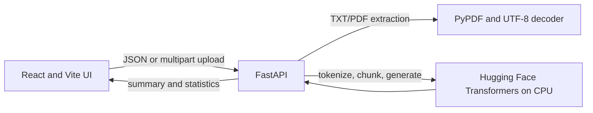

# Briefly AI — Abstractive Summarization System

A college Information Retrieval mini-project that turns long text and supported documents into shorter, newly generated summaries. The application uses a pretrained Hugging Face transformer through a local FastAPI service; no paid API or GPU is required.

## Features

- Paste text or upload UTF-8 `.txt` and text-based `.pdf` documents.
- Generate short, medium, or long abstractive summaries.
- View original and summary word counts and the word-count reduction.
- Copy or download summaries as text.
- Split longer inputs into token-limited chunks for model processing.
- Run inference on CPU.

## Architecture



The user interface runs on port 5173 and the API on port 8000. Model loading is lazy: health checks and application startup do not download model weights. The first summarization request downloads the configured model if it is not already cached.

## Information Retrieval relevance

The application demonstrates document text extraction, tokenization, input-length management, and query-independent summarization. Transformer-based abstractive generation is an NLP technique used here to produce a compact representation of a source document. This project does **not** implement a search engine, inverted index, TF-IDF retrieval, query processing, or document ranking. ROUGE evaluation is planned separately and is not part of the live summarization endpoint.

## Requirements

- Windows 10/11
- Python 3.10 or 3.11
- Node.js 20 or newer and npm
- 8 GB RAM minimum; 16 GB is more comfortable
- Internet for the first model download

## Windows setup

Open two PowerShell terminals in the project folder.

### Backend terminal

```powershell
cd backend
py -3.11 -m venv .venv
.\.venv\Scripts\Activate.ps1
python -m pip install --upgrade pip
pip install -r requirements.txt
python -m uvicorn app.main:app --reload
```

If PowerShell blocks activation, run `Set-ExecutionPolicy -Scope Process -ExecutionPolicy Bypass` and activate again. The API is at `http://127.0.0.1:8000`; interactive docs are at `/docs`.

### Frontend terminal

```powershell
cd frontend
npm install
npm run dev
```

Open the local URL printed by Vite, normally `http://localhost:5173`.

## Model

Default: [`sshleifer/distilbart-cnn-6-6`](https://huggingface.co/sshleifer/distilbart-cnn-6-6). It is a pretrained encoder-decoder summarization model selected for the starter application. CPU inference can be slow, especially on long input. The model files are downloaded from Hugging Face on first use and cached by the Hugging Face libraries. To select a compatible model, set the environment variable before starting FastAPI:

```powershell
$env:SUMMARIZATION_MODEL="sshleifer/distilbart-cnn-6-6"
python -m uvicorn app.main:app --reload
```

The current API accepts up to 30,000 characters and the document extractor accepts files up to 10 MB. PDF extraction only reads selectable text; scanned documents require OCR, which is not included. Generated text may omit information or contain unsupported claims. Check important facts against the source.

## API

| Method | Path | Purpose |
| --- | --- | --- |
| GET | `/api/health` | API/model configuration status (does not load the model) |
| POST | `/api/summarize` | JSON `{ "text": "...", "length": "short\|medium\|long" }`; returns a complete summary response |
| POST | `/api/summarize/stream` | Same JSON request; streams newline-delimited status, section progress, and final result events for the web UI |
| POST | `/api/extract-text` | Multipart upload field `file`; accepts `.txt` and `.pdf` |

Summary responses include generated text, both word counts, compression percentage, and the model identifier. Compression is the percentage reduction in whitespace-separated word count. The streaming endpoint reports completed and total sections; cancelling the browser request stops further sections after any active model operation returns. A single CPU inference call cannot be interrupted mid-operation.

## Checks

From `backend`:

```powershell
python -m unittest discover -s tests -v
```

From `frontend`:

```powershell
npm run build
```

The endpoint tests mock the model and do not download model weights. For a real inference check, start both services, provide at least 25 words in the UI, and allow the first request to download the model.

## Evaluation and limitations

ROUGE-1, ROUGE-2, and ROUGE-L evaluation against human-written references is a remaining milestone. Results must be measured on a documented labelled dataset before any scores are reported. ROUGE measures reference overlap; it does not establish factual accuracy, coherence, or usefulness. Evaluation also needs to record data preparation, split, software versions, and aggregate scores.

Other current limitations include CPU latency, chunk summaries that can lose cross-chunk context, unsupported scanned PDFs, and no automated OCR. This implementation is a demonstration rather than a production service.

## Project structure

```text
backend/
  app/main.py          FastAPI endpoints and summarization pipeline
  requirements.txt
  tests/test_api.py    Model-mocked API checks
frontend/
  src/App.jsx          React interface and interactions
  src/styles.css       Responsive visual design
  package.json
PROJECT_STATUS.md      Verified progress and resume instructions
```
